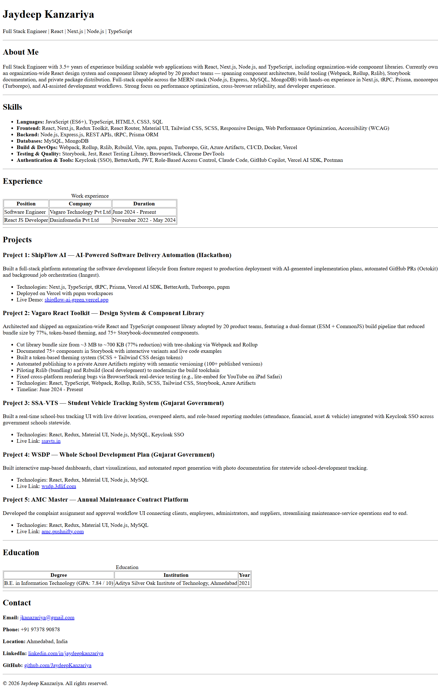

# HTML Resume Page — Jaydeep Kanzariya

A single-page semantic HTML resume website. Built purely with semantic HTML5 elements without any CSS.

**Live Demo:** [jaydeepkanzariya.github.io/html-resume-page](https://jaydeepkanzariya.github.io/html-resume-page/)

## Features & Semantic Structure

- **Header (`<header>`)**: Name (`<h1>`) and professional headline (`<p>`).
- **About Me (`<section>`)**: Professional summary (`<h2>`, `<p>`).
- **Skills (`<section>`)**: Categorized technical skills using an unordered list (`<ul>`, `<li>`).
- **Experience (`<section>`)**: Work history structured in a semantic HTML table (`<table>`, `<thead>`, `<tbody>`, `<tr>`, `<th>`, `<td>`).
- **Projects (`<section>`, `<article>`)**: Five featured projects (ShipFlow AI, Vagaro React Toolkit, SSA-VTS, WSDP, AMC Master) with descriptions, tech stacks, achievements, and live links (`<h3>`, `<p>`, `<ul>`).
- **Education (`<section>`)**: Academic background in a structured table (`<table>`, `<caption>`, `<th scope="col">`).
- **Contact (`<section>`)**: Email, phone, location, LinkedIn, and GitHub links.
- **Footer (`<footer>`)**: Copyright notice.

## Project Structure

```text
html-resume-page/
├── index.html       # Main single-page HTML resume
├── screenshot.png   # Output screenshot
└── README.md        # Project documentation and setup instructions
```

## Setup & Usage

No build tools or dependencies are required.

1. **Clone the repository:**
   ```bash
   git clone https://github.com/JaydeepKanzariya/html-resume-page.git
   cd html-resume-page
   ```

2. **Open in browser:**
   - Double-click `index.html`, or
   - Run a local static server (e.g., VS Code Live Server or `npx serve .`).

## Screenshot


